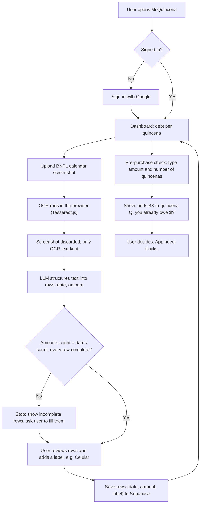
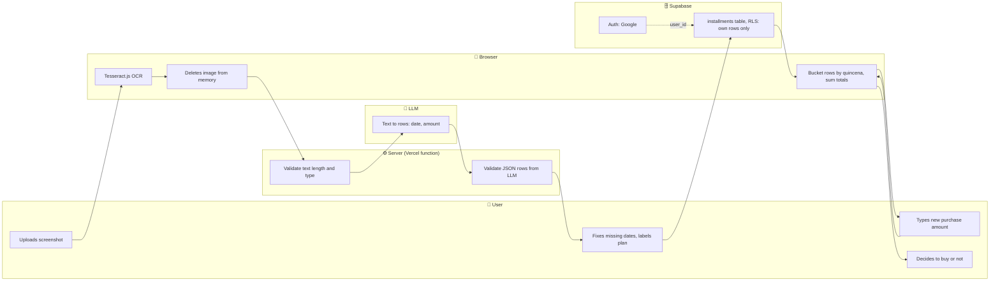

# PACKET — Week 10 Ship · Mi Quincena

**Nicolas Martinez · Crystal Ball Studio · Technologist · Vacuum: Debt guardrails**
Team blueprint: PAUSA MX (debt-guardrails module). Stack floor: 🐉 DRAGON STACK.

---

## 1. Problem in my words

In Mexico a person can carry three or four BNPL plans at once, each in a different app, each with its own calendar. No one shows them the one number that matters: **how much they already owe in each quincena, across all providers.** The seller shows "only $249 per quincena!" at checkout, never the total. There is no open-finance API to pull this data (Fintech Law Art. 76 rules were never published), so the only source the buyer fully controls is their own screen.

Mi Quincena is a mirror, not a guard: the user uploads screenshots of their payment calendars, the app extracts dates and amounts, groups them by quincena, and before a new purchase answers one question: *"this adds $X to your Nov 15 quincena; you already owe $Y."* It never blocks, never recommends a product, and earns nothing from lenders.

## 2. Exact user

**Fernanda (fictional), 23, cashier at a department store in Iztapalapa.** Paid every quincena (15th and last day of the month). Has three active BNPL plans in different apps: a phone, sneakers and a supermarket order. Shops on her phone during the commute. Knows each payment individually but has never added them up; found out she was short only when her pay arrived and the charges hit the same week. Doesn't want to connect her bank, doesn't read fine print, and quits any app that asks for too much before showing her something useful.

## 3. Success definition

> Before the module closes, **Fernanda can sign in with Google, upload one BNPL calendar screenshot, confirm the extracted dates and amounts, see her total debt per quincena across providers, and type a new purchase amount to see exactly which quincena it lands in and what she would owe in total** — on the live URL, from her phone.

Acceptance: the clean test calendar produces **$2,490.50** for the 1st November quincena; the blurred test calendar does **not** produce $2,141.50 silently — it stops and asks her to fill in the missing dates.

## 4. 🎨 Mockup

Image-generation prompt used:

> Mobile app screen mockup, clean flat UI, Spanish text, phone frame, light background, navy and warm coral accents. App name "Mi Quincena" at top. Large card: "1ª quincena de noviembre — Ya debes $2,490.50 — 3 planes". Below, a smaller card: "2ª quincena de noviembre — $1,120.00". Below that, an input labeled "¿Vas a comprar algo? Escribe el monto" with "$899 en 4 quincenas" typed, and a result box: "Esto suma $224.75 a tu quincena del 15 de nov. Total: $2,715.25". Small grey tag on extracted rows: "Leído de tu captura — revisa". Floating button "Subir captura". No bank logos, no product images, no ads.

## 5. 📊 Flow

### 5a. Flowchart — how the feature works

### 5b. Swimlane — who does what

## 6. 🌍 Benchmark line

**The best existing solution on Earth for this is** Finny (US), which logs Klarna, Afterpay and Affirm payments by reading the provider's screen, stages them for review, and reminds you before each due date — with no bank or BNPL account connection.

**Mine differs or localizes by** grouping debt by *quincena* instead of by due date, answering *before* the purchase ("this adds $X to your Nov 15 quincena"), refusing to sum when the OCR read more amounts than dates, deleting the screenshot after extraction, and writing zero lender revenue into the terms — in Spanish, for Mexican BNPL calendars.

## 7. 🔭 Long view (3 years)

If this slice works, Mi Quincena becomes the buyer-side ledger for everything Mexicans pay in quincenas: BNPL, tandas, store credit paid in cash, the cousin's loan — the debts no bank sees. When Mexico finally publishes transactional open-finance rules, it plugs in as a consent-based aggregator in the Indian model, never selling credit or ads, so it stays the one place with nothing to sell you. The load-bearing walls I keep from day one: user-owned minimal data, show-never-block, and no revenue from the seller side.

## 8. Scope cut — NOT building this week

- No bank, email or BNPL-account connection; no scraping of provider sites.
- No automatic screen interception or checkout overlay.
- No blocking, delaying or cancelling purchases; no "you shouldn't buy this".
- No credit score, approval/denial or risk rating (course forbidden zone; also against the shadow clause).
- No product recommendations, rankings or affiliate links (forbidden zone: seller-side).
- No income tracking beyond an optional "my quincena pay" number for context.
- No reminders/notifications, no multi-currency, no tandas or cash debts yet.
- No screenshot storage — ever.

## 9. Architecture + stack

| Layer | Choice (free tier) | Why |
|---|---|---|
| Front end | Next.js (App Router) + Tailwind, mobile-first, Spanish UI | One repo, deploys free on Vercel |
| Hosting | Vercel | Env vars for secrets; preview deploys |
| 🐉 Vision | **Tesseract.js in the browser** | The image never leaves the phone; same engine as my brief's test |
| 🐉 LLM | Gemini API free tier (via Vercel function) | Turns messy OCR text into strict JSON rows; receives text only, never the image |
| 🐉 User-constraint data | User's own installments (+ optional quincena pay) | The constraint the purchase is checked against |
| Auth | Supabase Auth — Sign in with Google | Security floor: personal data behind auth |
| Database | Supabase Postgres, RLS ON | `installments(id, user_id, due_date, amount, label, created_at)` |
| Validation | zod on client and server | Length/type limits before DB and before prompt |
| Fallback | Regex parser when LLM is unavailable | Output labeled "lectura automática sin IA" |

**Quincena rule:** due on day 1–15 → 1st quincena of that month; day 16–end → 2nd quincena.

**Never-undercount rule:** if OCR text yields more amounts than dates (or any row lacks date or amount), the app does not sum. It shows the incomplete rows and asks the user to fill them.

**AI labeling:** every extracted row shows "Leído de tu captura — revisa"; any simulated output is labeled on screen.

### 🛡️ Security floor mapping

| Check | How |
|---|---|
| No secrets in repo | `GEMINI_API_KEY`, Supabase service key only in Vercel env vars; `.env*` in `.gitignore` |
| Auth for personal data | Supabase Auth with Google; dashboard routes require session |
| RLS | Policies on `installments`: select/insert/update/delete where `user_id = auth.uid()` |
| Input validation | OCR text ≤ 4,000 chars; amount 0.01–100,000; date within −1/+24 months; label ≤ 40 chars; LLM output re-validated with zod |
| No real personal data | Demo uses my fictional, unbranded test calendars, labeled "datos ficticios" |

## 10. Test plan

**Mechanical pass**
1. Quincena bucketing unit tests: days 15, 16, 30, 31, Feb 28/29.
2. Clean fictional calendar → 12/12 rows, 1st Nov quincena = **$2,490.50**.
3. Blurred fictional calendar → app flags missing dates and refuses to sum; after user fills them, total = $2,490.50.
4. Pre-purchase check: $899 in 4 quincenas starting Nov 15 → +$224.75 per quincena, correct totals.
5. RLS: second Google account cannot read the first account's rows (test via Supabase client).
6. Validation: negative amount, 10,000-char text, 200-char label, malformed LLM JSON — all rejected cleanly.
7. Secrets: `git grep` for key patterns returns nothing.
Log at least one bug found → fix → redeploy.

**🎭 Persona pass**
Fresh chat, persona: *"You are Fernanda, 23, cashier in Iztapalapa, paid every quincena, three BNPL plans, shops on a cracked-screen phone on the metro, never reads small print, distrusts anything that asks to log in before showing value, quits silently when confused."* Paste each screen in order; she narrates hesitations. Log every confusion; fix the worst one before the deadline. Watch especially: the Google sign-in wall before any value, and the "fill missing dates" step.

**Demo (3 min + 30 s):** walk the live URL as Fernanda with the fictional calendars; close with what changed my mind this week.
